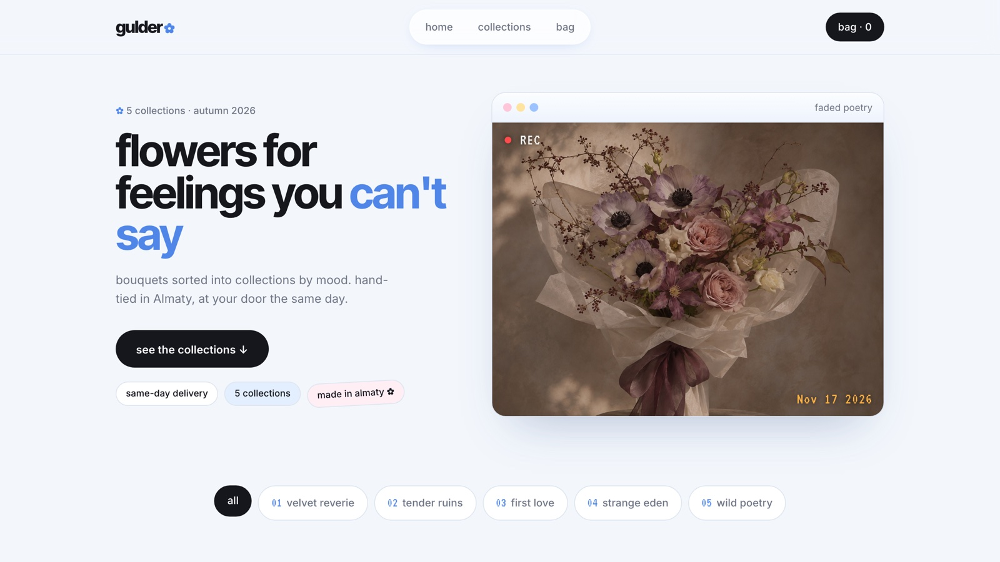
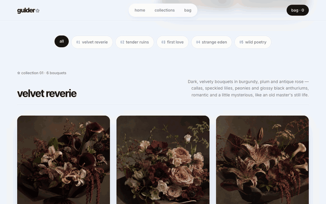
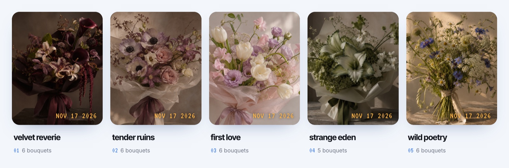
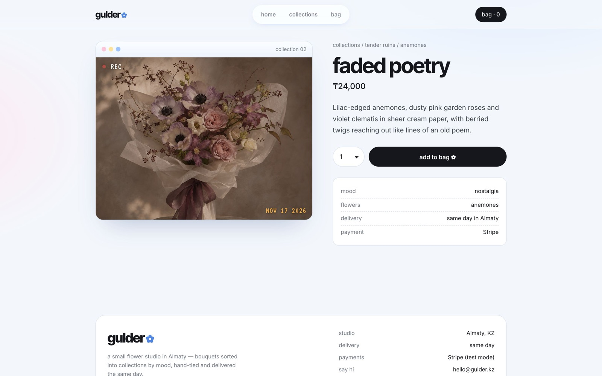
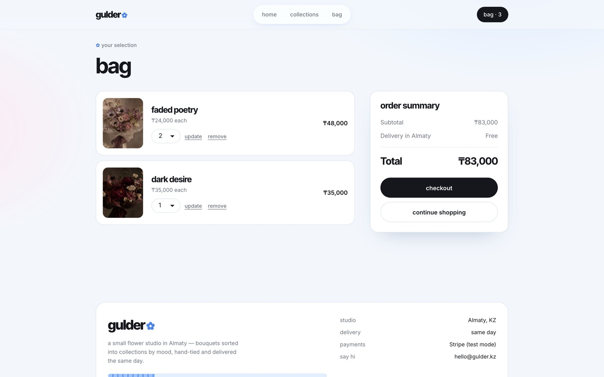
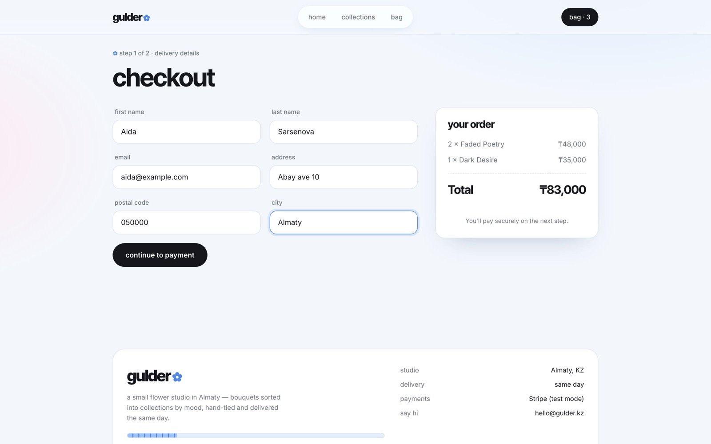
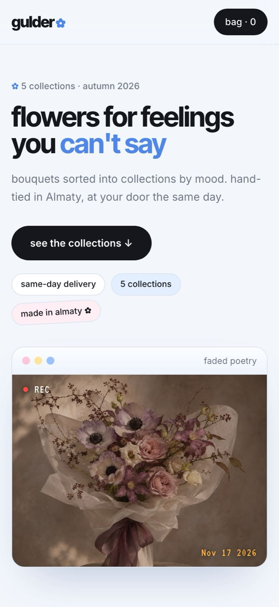
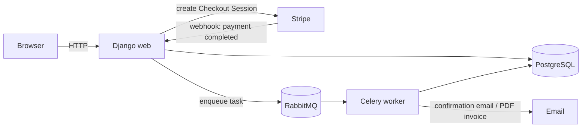

<h1 align="center">gulder ✿</h1>

<p align="center"><b>flowers for feelings you can't say</b><br>
a small flower shop with bouquets sorted into collections by mood</p>

<p align="center">
  
  
  
  
  
  
</p>



a full-stack **Django** e-commerce shop: curated collections, session cart, checkout,
**Stripe** payments confirmed via webhooks, and **Celery + RabbitMQ** background jobs
that email customers and generate PDF invoices. runs with one command via Docker Compose.

<p align="center">
  
</p>

## ✿ five collections, 29 bouquets



| | collection | mood |
|---|---|---|
| 01 | **velvet reverie** | dark, velvety burgundy and plum |
| 02 | **tender ruins** | airy, muted lilac and fading pink |
| 03 | **first love** | soft blush, peach and baby blue |
| 04 | **strange eden** | all-green and sculptural |
| 05 | **wild poetry** | loose meadow flowers and grasses |

the design is inspired by early-2000s nostalgia: sky-blue and white, bold lowercase type,
and every bouquet shown as a camcorder still with a date stamp.

> **image generation:** all bouquet photos were generated with OpenAI (DALL·E via ChatGPT).

<details>
<summary><b>more screens</b> — product, bag, checkout, mobile</summary>
<br>

| product | bag |
|---|---|
|  |  |

| checkout | mobile |
|---|---|
|  |  |

</details>

## ✿ features

- **collections** — bouquets belong to curated collections (`Collection` model) and carry
  a mood; the home page renders each collection as its own section using
  `prefetch_related` (one query per table, no N+1).
- **catalog** — filter by collection (`/collections/<slug>/`) or flower type, product pages,
  indexed queries.
- **bag** — session-based cart (no login needed), change quantity, remove items.
- **checkout** — order form; order items snapshot the price at purchase time.
- **payments** — Stripe Checkout Session in KZT; the order is marked paid only after a
  **signature-verified webhook** (`checkout.session.completed`), not on redirect.
- **async jobs** — Celery workers (RabbitMQ broker) send the order confirmation email and,
  after payment, an email with a **PDF invoice** rendered by WeasyPrint.
- **admin** — order list with a link to the payment in the Stripe dashboard,
  **CSV export** of selected orders, order detail page and PDF invoice download.

## ✿ architecture



**order flow:** bag (session) → `Order` + `OrderItem`s saved → `order_created` task queued →
redirect to Stripe Checkout → Stripe calls `/payment/webhook/` → order marked paid →
`payment_completed` task renders the PDF invoice and emails it.

## ✿ tech stack

| layer | tools |
|---|---|
| backend | Python, Django 5 |
| database | PostgreSQL (Docker) / SQLite (local dev) |
| payments | Stripe Checkout + webhooks |
| background jobs | Celery, RabbitMQ |
| pdf | WeasyPrint |
| frontend | Django templates, HTML, CSS |
| infra | Docker, Docker Compose |

## ✿ project structure

```
guldershop/   project settings, Celery app
shop/         collections, categories, products, catalog views, demo fixture
cart/         session cart + context processor
orders/       orders, checkout, admin CSV export / PDF, Celery email task
payment/      Stripe checkout, webhook, invoice task
```

## ✿ run locally

### with docker (recommended)

```bash
cp .env.example .env          # add your Stripe test keys
docker compose up --build
```

open http://localhost:8000 — the demo catalog is loaded automatically.
create an admin user: `docker compose exec web python manage.py createsuperuser`.

### without docker

```bash
python -m venv venv && source venv/bin/activate
pip install -r requirements.txt
cp .env.example .env
python manage.py migrate
python manage.py loaddata demo_catalog
python manage.py runserver
# in another terminal (needs RabbitMQ running):
celery -A guldershop worker -l info
```

no RabbitMQ? set `CELERY_TASK_ALWAYS_EAGER=True` in `.env` and tasks run inline.
PDF invoices need the Pango system library (`brew install pango` on macOS).

### stripe in test mode

```bash
stripe listen --forward-to localhost:8000/payment/webhook/
```

put the printed `whsec_...` into `STRIPE_WEBHOOK_SECRET`, then pay with the test card
`4242 4242 4242 4242`, any future date and any CVC.

## ✿ tests

```bash
python manage.py test
```

covers the catalog, grouping and filtering by collection, category filter, bag add/remove
totals, and checkout (order created, totals correct, confirmation email task queued).

## ✿ what i'd improve next

- REST API (Django REST Framework) so a mobile client can use the same backend
- stock tracking and idempotent webhook handling
- retries and dead-letter handling for Celery tasks
- CI with GitHub Actions (tests + lint on every push)

<p align="center"><sub>made with ✿ in almaty</sub></p>
